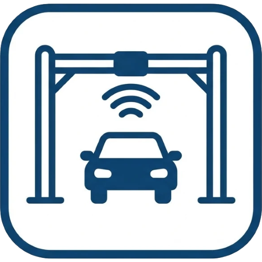

<p align="center"></p>

# Flyt bombrikke for Home Assistant

Uoffisiell integrasjon som henter passeringer for bombrikker hos
[Flyt](https://flytpass.no) via MinSide-API-et.

Integrasjonen logger inn på Flyt MinSide med jevne mellomrom og henter
brikkene, bilene og de siste bompasseringene dine. Den lager sensorer per bil:
siste passering, bomstasjon, pris og sum for måneden, pluss saldo per avtale.
Den sender også en hendelse for hver ny passering, som du kan bruke til varsler
og automasjoner.

> 🤖 **100 % vibecoded med Claude.** Hele integrasjonen, fra kartlegging av
> API-et til kode og feilretting, er laget i en samtale med
> [Claude Code](https://claude.com/claude-code). Se
> [Slik er det laget](#slik-er-det-laget).

> ⚠️ Ikke tilknyttet eller godkjent av Flyt. API-et er ikke offentlig
> dokumentert og kan endres uten varsel.

*English: Unofficial Home Assistant integration for Norwegian Flyt toll tags
(bombrikke). It polls Flyt MinSide for your tags, vehicles and recent toll
passings, and exposes them as sensors and a `flyt_new_passing` event. It was
entirely "vibecoded" with Claude Code.*

## Innlogging

MinSide bruker Azure AD B2C. BankID kan ikke automatiseres, og tokenene
nettsiden får utdelt utløper etter 24 timer. Integrasjonen logger derfor inn
med **e-post og passord**, slik "Har du ikke BankID? Trykk her" gjør på
innloggingssiden. Den fornyer tokenet selv og logger inn på nytt ved behov.

### Skaffe en e-postbruker med passord

Har du en e-postbruker med passord fra før, kan du bruke den direkte. Har du
glemt passordet, kan du nullstille det via **Har du ikke BankID? Trykk her →
Har du glemt passordet?** på innloggingssiden.

**Logger du vanligvis inn med BankID, har du sannsynligvis ingen
e-postbruker med passord.** Nullstillingen kan da ikke sette et passord.
Den sender riktignok en kode på e-post, men etterpå blir du bare sendt
tilbake eller logget inn uten å ha fått velge passord. Lag i stedet en ny
bruker:

1. Gå til [MinSide](https://minside-flyt.flytpass.no) og trykk
   **Har du ikke BankID? Trykk her → Registrer deg nå**.
2. Registrer deg med e-postadressen din, bekreft koden du får på e-post, og
   velg et passord.
3. Når du er logget inn med den nye brukeren, kommer du til siden **Kunder**.
   Velg **Finn avtale** («aktivere tilgang til eksisterende kundeforhold») og
   følg trinnene for å koble den nye brukeren til Flyt-kontoen din.
4. Bruk denne e-postadressen og dette passordet når du legger til
   integrasjonen i Home Assistant.

Du kan også gi en e-postbruker tilgang fra BankID-brukeren under
**MinSide → Tilgangsstyring → Gi tilgang**. Åpner du aktiveringslenken, må du
da logge inn med e-post og passord, ikke BankID. Ellers blir tilgangen koblet
til BankID-brukeren.

Du kan teste innloggingen uten Home Assistant med `test_flyt.py` (se
[Test uten Home Assistant](#test-uten-home-assistant)).

## Installasjon

### Med HACS – Home Assistant Community Store (anbefalt)

1. I Home Assistant: **HACS → ⋮ (øverst til høyre) → Egendefinerte repositorier**.
2. Lim inn `https://github.com/Kr0ll/flytpass-homeassistant` og velg kategori
   **Integrasjon**.
3. Søk opp **Flyt bombrikke** i HACS, last den ned og start Home Assistant på nytt.
4. Gå til **Innstillinger → Enheter og tjenester → Legg til integrasjon → Flyt bombrikke**
   (*Settings → Devices & services → Add integration*)
   og logg inn med e-post og passord.

[](https://my.home-assistant.io/redirect/hacs_repository/?owner=Kr0ll&repository=flytpass-homeassistant&category=integration)

### Manuelt

Kopier `custom_components/flyt` til `config/custom_components/flyt`, start Home
Assistant på nytt og legg til integrasjonen som over.

## Hva du får

Én enhet per aktive brikke (navngitt etter registreringsnummer og bil), med:

> 🌐 Navnene i Home Assistant følger språket du har valgt der. Denne
> veiledningen bruker norske navn med de engelske i parentes eller i en egen kolonne.

| Norsk | English | Beskrivelse |
|---|---|---|
| Siste passering | Last passing | Tidspunkt (attributter: stasjon, operatør, pris, skiltnummer, de 10 siste passeringene) |
| Siste bomstasjon | Last toll station | Navn på stasjonen |
| Pris siste passering | Last passing price | NOK |
| Bompenger denne måneden | Tolls this month | Sum NOK, nullstilles den 1. (attributter `toll` og `ferry`: summen for bom og ferje hver for seg) |
| Passeringer denne måneden | Passings this month | Antall (attributt `passings`: hele månedens liste med tid, stasjon, operatør, pris, type og posisjon) |
| Siste posisjon | Last position | Kartentitet (`device_tracker`) som står på siste bomstasjon eller ferjekai brikka ble lest på |
| Vis på kart | Show on map | Bryter som viser eller skjuler bilen på kartet (se [Kart](#kart-over-passeringene)) |

I tillegg får du en **Saldo** (*Account balance*)-sensor per aktive avtale (negativ betyr at du skylder Flyt).

## Innstillinger

Gå til **Innstillinger → Enheter og tjenester → Flyt bombrikke**
(*Settings → Devices & services*).

### ⚙ Konfigurer (*Configure*)

| Valg | English | Standard | Beskrivelse |
|---|---|---|---|
| Oppdateringsintervall | Polling interval | 30 min | Hvor ofte nye data hentes fra Flyt (10–1440 minutter) |
| Vis alle passeringer på kartet | Show all passings on the map | av | Kartpunkt per bil og stasjon den har passert (se [Kart](#kart-over-passeringene)) |

Integrasjonen lastes inn på nytt når du lagrer.

> ⚠️ **Ikke sett intervallet for kort.** Integrasjonen bruker et uoffisielt
> API. Svært hyppige oppslag kan få Flyt til å reagere på trafikken, og i
> verste fall kan kontoen bli strupet eller stengt ute. 30 minutter eller mer
> anbefales. Du går heller ikke glipp av noe: bompasseringer dukker ofte opp
> hos Flyt timer eller dager etter at de skjedde.

### Endre e-post eller passord (⋮ → Rekonfigurer / *Reconfigure*)

Vil du bytte e-postbruker eller oppdatere passordet, velger du **⋮ → Rekonfigurer**
på integrasjonen. Den nye innloggingen testes før den lagres. Du trenger ikke
slette og legge til integrasjonen på nytt. Endrer du passordet på MinSide, ber
Home Assistant deg selv om det nye passordet neste gang innloggingen feiler.

## Liste over månedens passeringer på dashbordet

Sensoren *Passeringer denne måneden* har alle passeringene for måneden i
attributtet `passings`. Med et **Markdown-kort** kan du vise dem som en tabell.
Gå til dashbordet, velg **Rediger → Legg til kort → Markdown → Vis koderedigering**
(*Edit → Add card → Markdown → Show code editor*)
og lim inn dette:

```yaml
type: markdown
title: Bompasseringer denne måneden
content: |
  
  
  
  
  
  
  
  | Tid | Bil | Stasjon | Pris |
  |:--|:--|:--|--:|
  
  | {{ p.when }} | {{ p.car or '' }} | {{ p.station or '' }} | {{ '%.2f' | format(p.price) }} kr |
  
  **Totalt {{ '%.2f' | format(rows | sum(attribute='price')) }} kr for {{ rows | count }} passeringer**
```

Kortet viser alle bilene samlet. Vil du bare vise én bil, bytter du ut
`states.sensor | selectattr(...)` med for eksempel
`[states.sensor.ab12345_bilnavn_passeringer_denne_maneden]` (engelsk:
`…_passings_this_month`). Riktig entitets-ID finner du under
**Innstillinger → Enheter og tjenester → Entiteter** (*Settings → Devices & services → Entities*).

Listene lagres ikke i Home Assistant-databasen. De finnes bare i gjeldende
tilstand og fyller derfor ikke opp historikken.

## Kart over passeringene

Hver bil kan vises på et kart der brikka sist ble lest, og alle bomstasjoner og
ferjekaier den har passert kan vises som punkter. Posisjonene kommer fra
Statens vegvesens åpne vegdatabase (se [Hvor posisjonene kommer fra](#hvor-posisjonene-kommer-fra)).

### Sett opp kartet

**1. Slå på alle passeringer**

Gå til **Innstillinger → Enheter og tjenester → Flyt bombrikke → ⚙ Konfigurer**
(*Settings → Devices & services → Flyt bombrikke → Configure*), huk av for
**Vis alle passeringer på kartet** (*Show all passings on the map*) og lagre. Punktene dukker opp når
integrasjonen har lastet inn på nytt, som skjer med en gang du lagrer.

**2. Finn entitets-ID-ene**

Gå til **Innstillinger → Enheter og tjenester → Entiteter**
(*Settings → Devices & services → Entities*) og søk etter:

| Søk etter | Entitet | Norsk ID | Engelsk ID |
|---|---|---|---|
| «posisjon» / «position» | Siste posisjon (*Last position*) | `device_tracker.ab12345_bilnavn_siste_posisjon` | `device_tracker.ab12345_bilnavn_last_position` |
| «kart» / «map» | Vis på kart (*Show on map*) | `switch.ab12345_bilnavn_vis_pa_kart` | `switch.ab12345_bilnavn_show_on_map` |

ID-ene lages av skiltnummer, bilmodell og navnet på entiteten, på det språket
Home Assistant hadde da integrasjonen ble lagt til. Du trenger ikke skrive dem av:
se tipset i trinn 3.

**3. Lag kortet på et dashbord**

Kortet må lages på et **dashbord**, ikke på *Kart*-siden (*Map*) i menyen (se
[Hva du ser](#hva-du-ser)). Åpne dashbordet, trykk **✏️ Rediger → + Legg til kort**
(*Edit → Add card*), bla ned til **Manuelt** (*Manual*), og lim inn dette:

```yaml
type: vertical-stack
cards:
  - type: map
    title: Bompasseringer
    hours_to_show: 720          # spor for de siste 30 dagene (0 = uten spor)
    entities:
      - entity: device_tracker.ab12345_bilnavn_siste_posisjon
        label_mode: attribute
        attribute: registration_number    # skiltnummer på markøren
      - entity: device_tracker.cd67890_bilnavn_siste_posisjon
        label_mode: attribute
        attribute: registration_number
    geo_location_sources:
      - source: flyt                       # alle passeringene (trinn 1)
        label_mode: attribute
        attribute: count                   # antall passeringer på markøren
  - type: entities
    title: Vis på kart
    entities:
      - switch.ab12345_bilnavn_vis_pa_kart
      - switch.cd67890_bilnavn_vis_pa_kart
```

> 💡 **Tips: Bytt til dine egne biler i den grafiske editoren.** Når koden er
> limt inn, trykker du **Vis visuell editor** (*Show visual editor*). Kortet
> får da to faner øverst:
> - **1** er kartet. Trykk på hver bil og velg din egen *Siste posisjon*-entitet
>   fra listen. Med **+ Legg til entitet** (*Add entity*) får du med flere biler.
> - **2** er bryterne. Bytt dem til dine *Vis på kart*-brytere på samme måte.
>
> Da trenger du ikke vite entitets-ID-ene på forhånd. Biler du legger til med
> **+ Legg til entitet** får ikke skiltnummer på markøren automatisk. Gå tilbake
> til **Vis koderedigering** (*Show code editor*) og legg til `label_mode` og
> `attribute` under dem, slik som for de andre bilene.

Trykk **Lagre** (*Save*).

**4. Velg hvilke biler som vises**

Kartkortet har ingen avkrysning per bil. Bruk bryterne under kartet i stedet. Når
**Vis på kart** er av for en bil, forsvinner både bilen og passeringspunktene dens
fra kartet. Valget huskes over omstarter.

### Hva du ser

- **Markør med skiltnummer:** hvor bilen sist passerte en bom eller ferjekai.
- **Markør med et tall:** en bomstasjon eller ferjekai bilen har passert de
  siste 45 dagene. Tallet er antall passeringer der. Én bil som har kjørt samme
  bom ti ganger, gir ett punkt med «10», ikke ti punkter.
- **Strek bak bilen:** sporet fra `hours_to_show`. Det bygges av posisjonene Home
  Assistant har sett ved hver oppdatering. Kommer flere passeringer inn samtidig,
  blir bare den siste et punkt i sporet.
- **Trykk på en markør** for detaljer (*Attributes*): stasjon, bil, type (bom eller ferje),
  antall, sum og tidspunkt for siste passering.

> **Kart-siden i menyen** (*Map*) viser automatisk alle entiteter med posisjon, også
> passeringspunktene. Der kan du ikke velge hva markørene viser, så de får
> forbokstavene i navnet (for eksempel «K-R» for «Klett - Rv.707»). Bruk
> dashbordkortet over for skiltnummer og antall.

Uten `label_mode` viser også dashbordkortet forbokstaver. Andre valg er
`label_mode: icon` (bil-ikon) eller `name: Audi` (egen tekst).

### Hvor posisjonene kommer fra

Hver passering kobles til en GPS-posisjon fra
[NVDB](https://nvdbapiles.atlas.vegvesen.no), Statens vegvesens åpne vegdatabase:

- **Bomstasjoner** kobles på operatør-ID og stasjons-ID, som er de samme hos Flyt
  og i NVDB. Det gir nøyaktig posisjon.
- **Ferjer** kommer som vanlige passeringer, ofte to linjer per tur (billett og
  et tillegg). De kobles på navnet til avreisekaien, for eksempel «Valset ferjekai».
  Dette fungerer for de fleste samband, men kan bomme der Flyt og NVDB skriver
  kainavnet ulikt.
- Passeringer som ikke kan kobles, som utenlandske bommer, kommer fortsatt med
  i lister og summer, bare uten posisjon. Den komplette listen med koordinater
  ligger i attributtet `passings` på sensoren *Passeringer denne måneden*.

Integrasjonen henter listen over bomstasjoner og ferjekaier fra NVDB omtrent én
gang i uka og lagrer den lokalt i Home Assistant. Det blir ingen ekstra trafikk
mot Flyt.

> 🔒 **Personvern:** Sporet og passeringspunktene viser omtrent hvor og når
> bilene har kjørt. Tenk på det før du deler dashbord eller skjermbilder. Vil du
> ikke ha en bil på kartet, slår du av *Vis på kart* for den.

## Hendelse ved ny passering

For hver ny passering sendes hendelsen `flyt_new_passing` med feltene `time`, `station`, `kind` (`toll` eller `ferry`), `latitude`, `longitude`,
`operator`, `price`, `currency`, `license_plate`, `registration_number`, `vehicle`, `obe_number` og `id`.

```yaml
automation:
  - alias: Varsel ved bompassering
    triggers:
      - trigger: event
        event_type: flyt_new_passing
    actions:
      - action: notify.mobile_app_telefon
        data:
          message: >
            {{ trigger.event.data.registration_number }} passerte
            {{ trigger.event.data.station }} ({{ trigger.event.data.price }} kr)
```

## Test uten Home Assistant

```
pip install aiohttp
python test_flyt.py
```

## Slik er det laget

Prosjektet er laget uten at noen har skrevet kode for hånd. Alt kom fram i en
samtale med Claude Code (Anthropic), der eieren beskrev hva de ville ha, logget
inn selv der det trengtes, og testet resultatet. Omtrent slik gikk det:

1. **Kartlegging av nettsiden.** Claude åpnet MinSide i en nettleser, leste
   JavaScript-koden til siden og fant API-gatewayen
   (`func-flyt-tsp-self-gateway-prod.azurewebsites.net`) og endepunktene.
2. **Observasjon av ekte trafikk.** Eieren logget inn selv med BankID. Claude
   fulgte med på API-kallene siden gjorde, for å se forespørsler og svarformat
   for kunder, brikker og passeringer.
3. **Innloggingsproblemet.** Tokenene Microsoft Azure B2C gir nettsiden,
   utløper 24 timer etter innlogging, uansett hvor ofte de fornyes. BankID kan
   heller ikke automatiseres. Løsningen ble en egen e-postbruker med passord som
   får tilgang via *Tilgangsstyring*. Integrasjonen logger inn som den på samme
   måte som nettsidens skjulte e-post/passord-skjema.
4. **Koding.** Claude skrev integrasjonen: API-klient, config flow,
   koordinator, sensorer, oversettelser og et frittstående testskript.

Passord, BankID og kontoopprettelse ble alltid gjort av eieren selv, ikke av
Claude.

## Begrensninger

- Passeringer dukker ofte opp hos Flyt timer eller dager etter at de skjedde.
- Nye brikker eller biler kommer først med når integrasjonen lastes inn på nytt.
- Posisjonene kommer fra NVDB. Ferjekaier kobles på navn og kan i sjeldne tilfeller mangle eller bli feil.
- Passordet lagres i Home Assistant-konfigurasjonen, slik det gjøres for
  andre integrasjoner med brukernavn og passord. Bruk et eget passord for
  e-postbrukeren.
